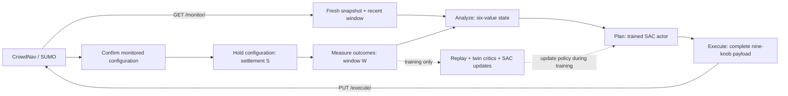

# SAC-RL adaptation design

Design and experiment notes, 19 November 2026. This folder contains the proposed implementation and the first analysis of existing experiment data. SAC training, the SAC runner options, and actor export are not implemented yet.

Start with [the architecture](architecture.md) for the state, networks, reward, and adaptation lifecycle. Use [the experiment plan](experiments.md) for the evidence already available and the next experiments.

## Starting point

The supplied [CrowdNav slides](</Users/gbianchi/Downloads/CrowdNav 1-3 (1).pdf>), slides 13-17, propose SAC with two controls, offline training, and a trained actor inside the UPISAS MAPE-K loop. This design keeps that structure and makes application confirmation, settlement, and reward measurement explicit.

The three submitted source files remain:

```text
UPISAS/exemplars/crowdnav.py
UPISAS/strategies/my_strategy.py
run_challenge.py
```

This design folder belongs to development. It is not part of the three-file submission on `main`; no new implementation module, required checkpoint file, or change to the original `Knowledge` class is needed. The submission still overlays the original UPISAS framework. See the existing [submission boundary](../../../wiki/submission.md).

## Initial choices

| Part | Proposed first experiment |
| --- | --- |
| Observation | Six scalars: recent overhead, completion rate, active-car fraction, car-count trend, current exploration, current rerouting interval |
| Actor | `6 -> 32 -> 32 -> (mean[2], log_std[2])`, ReLU hidden layers |
| Critics | Two independent `8 -> 64 -> 64 -> 1` Q networks, each with a target copy |
| Actions | Exploration in `[0, 0.5]`; integer rerouting interval in `[30, 600]` ticks |
| Decision cadence | Confirm application, wait `S` ticks, then measure for `W` ticks; one outstanding action |
| Provisional timing | Duration-based calibration; initial long-hold probe `S = 1800`, `W = 600`, not a validated delay |
| Main reward | Relative improvement from the stable pre-adjustment window to the post-settlement window; exclude application and settlement from both measurements |
| Training | Repeated seeded CrowdNav simulations; stochastic actor and replay-based learning |
| Evaluation/deployment | Frozen deterministic actor; no critic, replay, or gradient updates |

These are hypotheses to test, not tuned settings. A smaller state and network reduce learning complexity, but collecting useful adaptation transitions is likely to dominate the training cost.

The saved five-seed logs give corrected mean trip durations of approximately **539 ticks for the bad baseline and 413 ticks for the reactive policy**. A 200-tick window immediately following an action therefore observes trips with substantial exposure to the previous configuration. A large completion count does not fix this attribution problem. Timing must allow for routing response and trip duration, including its upper tail. Duration is controller/calibration metadata; it does not need to enlarge the actor's six-value state.

Keep both car-count level and trend: 750 cars with a rising population describes a different situation from 750 cars with a falling population. Estimate the trend over a recent simulation-time window rather than between arbitrary HTTP polls. Changing-population training scenarios are needed before claiming that the actor can use this feature.



## Fitting everything into three files

| File | Proposed responsibility |
| --- | --- |
| [crowdnav.py](../../UPISAS/exemplars/crowdnav.py) | HTTP access, startup readiness, consistent snapshot validation. Keep Docker ownership outside the deployment wrapper. |
| [my_strategy.py](../../UPISAS/strategies/my_strategy.py) | `SACStrategy`, bounded observation history, window arithmetic, phase machine, action conversion, embedded deterministic actor. A training-only factory can define the Gymnasium adapter after lazy imports. |
| [run_challenge.py](../../run_challenge.py) | Select the strategy, run MAPE-K, stop at the absolute horizon. Optional training/evaluation/export modes own seeded episode orchestration and actor export. |

Keep the existing baseline, fixed, reactive, and rule-based policies available for comparisons. Store controller state on the strategy instance and use the existing `knowledge.analysis_data` and `knowledge.plan_data` dictionaries; do not add fields to `knowledge.py`.

Training checkpoints, replay snapshots, raw events, package versions, and plots go under the existing ignored `experiments/` directory. The deployment path must import and run with only the original framework dependencies. Every training-only dependency must be imported inside the training factory or runner mode.

## Do we need external libraries?

For practical SAC training, **yes**: use a tested learner and automatic differentiation. For running a small, already-trained actor, **no additional library is necessary** beyond the existing UPISAS dependencies.

| Option | Benefit and cost | Decision |
| --- | --- | --- |
| Stable-Baselines3 + Gymnasium + PyTorch | Existing SAC learner and environment interface; adds a training dependency stack | Recommended for the first experiments |
| PyTorch with our own SAC learner | More control over variable-duration rewards and updates; we own replay, losses, entropy tuning, and checkpoint correctness | Consider only if measured timing requires custom SAC behavior |
| NumPy with manual differentiation | Fewer packages, much more algorithm code and verification | Poor tradeoff for this assignment |
| Python standard library for actor inference | Tiny matrix operations, ReLU, and `math.tanh`; requires export parity checks | Recommended for the submitted policy |

SB3 supports continuous `Box` actions and separate actor/critic layer sizes. Its installation also brings transitive dependencies; the package manager and a saved environment manifest should capture the actual resolved set. See [SAC support](https://stable-baselines3.readthedocs.io/en/master/modules/sac.html), [policy customization](https://stable-baselines3.readthedocs.io/en/master/guide/custom_policy.html), and [installation](https://stable-baselines3.readthedocs.io/en/master/guide/install.html).

Use a separate training environment so experiments do not change the current runner environment. The eventual setup is:

```sh
python3 -m venv .venv-sac
.venv-sac/bin/python -m pip install -r requirements.txt
.venv-sac/bin/python -m pip install stable-baselines3 gymnasium torch
.venv-sac/bin/python -m pip freeze > experiments/sac-training-packages.txt
```

Create `experiments/` first if it does not exist. These commands are setup guidance; no packages were installed for this design. Do not commit the virtual environment. Resolve compatible releases, save their exact versions and Python/platform details, then reuse that environment for comparisons. CPU training is the starting choice for these small networks; measure simulation and learning time before considering acceleration.

The checked installation documentation currently requires Python 3.10+ and PyTorch 2.8+; validate the selected stable release on the target machine. A three-file source submission does not itself make these packages available in the grading environment. [SB3 prerequisites](https://stable-baselines3.readthedocs.io/en/master/guide/install.html)

## Shipping a trained policy

Export the actor's two hidden layers and mean head as Python numeric constants into a delimited section of `my_strategy.py`. Embed the feature order, normalizers, action bounds, timing settings, and model identifier alongside the weights. Deployment computes `tanh(mean(state))`, then applies exactly the training action mapping.

With the proposed network, the training actor has 1,412 parameters. The deterministic export has 1,346 because the log-standard-deviation head is unnecessary. Each critic has 4,801 parameters and stays in the training environment, together with its target, optimizer, replay buffer, and entropy coefficient.

Exporting weights as source solves the fourth-file problem. It adds a responsibility: compare the Python actor against the trained framework actor on representative and boundary states before submission. Missing or invalid weights must produce an explicit error or an explicitly selected fixed-policy fallback; an untrained random actor must never be presented as a trained SAC policy.

## Decisions to resolve experimentally

1. How long after confirmed application do routing response and trip turnover make the outcomes predominantly reflect the new configuration?
2. After that duration-based settlement, is a shorter measurement sufficiently representative, or should it span at least another average trip duration?
3. Does the six-feature state improve over a fixed configuration on unseen seeds, and does car-count trend help under changing workloads?
4. Does a throughput safeguard prevent rewarding configurations that delay difficult trips beyond the window?
5. Does the frozen actor improve the whole-run grading median as well as the settled-window mean?

The first implementation should establish a trustworthy measurement lifecycle before adding network training. Existing data can check trip counts and window arithmetic; it cannot establish SAC performance or a causal settlement guarantee.
