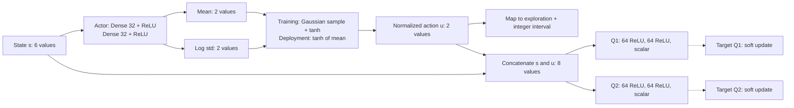
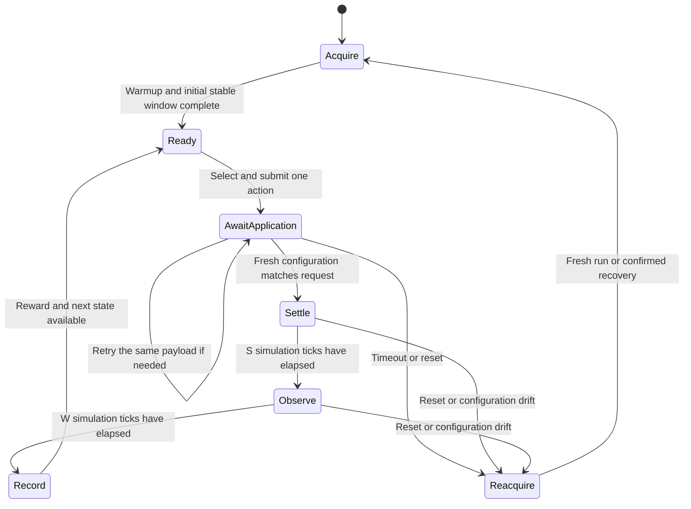

# Architecture and learning contract

All sizes, bounds, reward coefficients, and timing values below are proposed experiment settings. The [experiment plan](experiments.md) defines how to calibrate them.

## A lean observation

At decision `k`, use the latest completed measurement window under the current configuration:

```text
s_k = [H_recent / H_scale,
       q_recent / q_ref,
       driving_car_counter / N_ref,
       population_slope * T_N / N_ref,
       2 * exploration_percentage / p_max - 1,
       2 * log(re_route_every_ticks / R_min) / log(R_max / R_min) - 1]
```

| Value | Source | Reason to keep it |
| --- | --- | --- |
| `H_recent` | Recent completed-trip overhead mean | Current routing quality |
| `q_recent` | Completed smart-car trips divided by elapsed simulation ticks in that window | Progress signal; overhead alone can hide delayed completions |
| Active-car fraction | Latest `car_stats.driving_car_counter` | Population actually present can differ from target population |
| Car-count trend | Recent change in active-car count per simulation tick | Distinguishes growing, stable, and shrinking traffic at the same population |
| Current exploration | Latest confirmed `configs.exploration_percentage` | The same traffic observation can require a different action from a different configuration |
| Current rerouting interval | Latest confirmed `configs.re_route_every_ticks` | Distinguishes the current routing behavior |

`N_ref = 750` for the challenge. Estimate positive `H_scale` and `q_ref` from calibration runs on training seeds, then freeze them. Use the same constants in training, validation, export, and deployment. These constants scale actor inputs; `H_scale` is not the reward's comparison baseline. Keep the starting action bounds at `p_max = 0.5`, `R_min = 30`, `R_max = 600`.

For the first version, compute the average first derivative over the same settled window as the other performance features:

```text
population_slope = (N_end - N_start) / (step_end - step_start)
population_trend = population_slope * T_N / N_ref
```

Use actual `driving_car_counter` values at the two boundaries, with `T_N = 600` simulation ticks as a fixed normalization scale. For example, a rise from 700 to 760 cars over 600 ticks gives slope `+0.1` cars/tick and normalized trend `+0.08`; the reverse change gives `-0.08`. Keep the current population as well: a derivative alone cannot distinguish a stable low population from a stable high population. A longer recent window or a fitted slope can reduce noise from vehicles completing and restarting trips; test that before treating every fluctuation as a demand change. Repeated polls at the same step cannot provide a derivative.

`configs.total_car_counter` is the target population, while `driving_car_counter` is the actual population. Use actual count and trend in this initial state and log both. If future scenarios express demand primarily through the target setting, test its trend separately instead of silently changing this feature's meaning. The derivative is backward-looking and helps indicate a trend; it does not predict an arbitrary future demand change.

Validate finite values before normalization. Use an observation space with unbounded nonnegative performance levels, an unbounded signed population-trend feature, and bounded configuration features; do not silently clip a serious congestion signal into an apparently ordinary state. Validate that the current configuration is in the supported action range. An external out-of-range change requires reacquisition under a logged fallback, not a mislabelled SAC transition.

Omit complaint rate initially: complaints are a random consequence of overhead, so they add noise and partly duplicate the main signal. Omit raw cumulative counters, wall-clock tick cost, absolute tick, and the seven uncontrolled knobs. Continue logging them for diagnosis. Retain population level and trend to support future changing-demand scenarios, then test the trend's value on ramps and drops. Fixed-demand runs alone cannot establish that it helps. Add one lagged overhead feature only if experiments show that delayed effects need additional history.

This is an approximate state for a partially observed system. A lean vector does not make the traffic process Markovian. Longer settlement and a history ablation must be tested against the available number of decisions.

## Actor and critics

Use the modern SAC variant with twin Q functions, target Q copies, and entropy tuning. The extra value network used by early SAC variants is unnecessary here. [SAC formulation](https://spinningup.openai.com/en/latest/algorithms/sac.html), [automatic temperature tuning](https://arxiv.org/abs/1812.05905)



The critics estimate entropy-regularized future return for a state/action pair; they do not directly predict trip duration. Use independent critic parameters and target copies. Keep their output linear. The larger critic layers are a starting allowance for noisy value estimation, while the deployed actor remains small.

During training, sample a Gaussian using the actor's mean and standard deviation, then apply `tanh`. Use the learner's numerically stable log-probability calculation including the squashing correction. In deterministic evaluation, use `tanh(mean)`; it is the standard deterministic policy choice, not the exact expected value of the squashed distribution.

The following is a proposed learner configuration, not executable integration with today's runner:

```python
SAC(
    "MlpPolicy",
    env,
    policy_kwargs={"net_arch": {"pi": [32, 32], "qf": [64, 64]}},
    learning_rate=3e-4,
    buffer_size=50_000,
    learning_starts=256,
    batch_size=64,
    gamma=0.95,
    tau=0.005,
    train_freq=1,
    gradient_steps=1,
    ent_coef="auto",
    target_entropy=-2.0,
    device="cpu",
    seed=learner_seed,
)
```

`gamma` is per complete adaptation decision, not per SUMO tick. Avoid many gradient updates against a tiny collection of highly correlated transitions. These choices need validation in CrowdNav; library defaults do not establish suitable settings. [SAC configuration interface](https://stable-baselines3.readthedocs.io/en/master/modules/sac.html)

For each replay tuple `(s, u, r, s_next, terminal)`, both critics regress toward:

```text
u_next ~ actor(s_next)
y = r + gamma * (1 - terminal)
        * (min(target_Q1(s_next, u_next), target_Q2(s_next, u_next))
           - alpha * log_pi(u_next | s_next))
```

The actor minimizes `mean(alpha * log_pi(u | s) - min(Q1(s,u), Q2(s,u)))`. Targets follow `target = (1 - tau) * target + tau * critic`. Keep target computation out of gradient tracking. These are learner responsibilities, not code to duplicate when using SB3. [Twin-Q losses and targets](https://spinningup.openai.com/en/latest/algorithms/sac.html)

## Action mapping

Expose a continuous Gymnasium `Box(-1, 1, shape=(2,))`. For normalized action `u`:

```text
p = p_max * (u[0] + 1) / 2
R = round(exp(log(R_min) + (u[1] + 1) / 2 * log(R_max / R_min)))
R = integer_clamp(R, R_min, R_max)
```

Log scaling gives more resolution at short rerouting intervals. Rounding makes the physical control partly discrete; the continuous SAC interface is a practical approximation that should be checked for boundary saturation and ineffective tiny interval changes.

The replay action is the normalized `u` actually supplied to this deterministic mapping. Record the requested and confirmed physical values alongside it. Do not replace `u` with a rounded physical value in replay: that would change the learner's action convention and entropy calculation. Unexpected application of another configuration invalidates the transition; a fallback must not be labelled as the actor's requested action.

The bounds restrict the first experiment, not the API. The API allows exploration up to 1 and any positive integer rerouting interval. The proposed range includes the challenge's bad starting setting `(0.5, 600)` and the existing fixed reference `(0.0, 60)`. Widen the range only as a separate experiment.

Build the complete nine-knob payload from the latest confirmed configuration and replace only `exploration_percentage` and `re_route_every_ticks`. Preserve the other seven values, especially `total_car_counter = 750`. Check types, finiteness, and our chosen action bounds locally. Preserve the existing workaround for the execute schema's erroneous `edge_average_influence <= 1` restriction; do not clamp the real default of 140 to fit that schema.

SAC exploration and CrowdNav's exploration knob are different: the former randomizes the agent's chosen configuration during training; the latter changes route selection inside the managed system even when the agent is deterministic.

## Application, settlement, observation



1. **Acquire.** Require increasing simulation steps, valid counters, and real configuration data. The current simulator records smart-car trips only after tick 200. Hold the initial monitored configuration through settlement and one complete observation window to obtain `s_0` and the first pre-adjustment mean; there is no actor transition for this initial hold.
2. **Plan/execute.** Save `s_k`, its pre-adjustment window boundaries and measured `H_before`, `u_k`, the complete command, and the decision step. Allow one outstanding command. Check HTTP status and the response's JSON `status`.
3. **Confirm.** An accepted Kafka command is not evidence of application. Start the clock at `t_ack`, the first fresh snapshot whose configuration matches the complete expected payload, with tolerance only for floats. A no-op action is confirmed by the current fresh snapshot but still follows the same timing contract.
4. **Settle.** Keep the action fixed. At the first snapshot at or after `t_ack + S`, save a new cumulative-statistics boundary. Discard settlement completions from this action's reward.
5. **Observe.** Keep the action fixed for another `W` ticks. At the first snapshot reaching the observation deadline, compute the mean and completion rate between the actual two boundary snapshots.
6. **Record.** Compare this window's `H_after` with the saved `H_before`; exclude the application/settlement gap from both. Construct `s_next` from the new window and the confirmed configuration. Emit one transition and, in training only, let the learner update. Reuse this settled after window as the next action's before window when the next decision follows it immediately; otherwise refresh a recent stable window first.

Use simulation ticks for all policy timing. Wall-clock time is only for HTTP and liveness deadlines. Polling can skip ticks; log scheduled boundaries, actual boundaries, and lateness. Never invent boundary samples by interpolation. Repeated snapshots produce no decisions or transitions. Keep only the snapshots and rolling summaries needed by the phase machine; the original framework otherwise accumulates unbounded lists.

Application retries resend the same full payload. An initial proposal is 200 simulation ticks between retries, at most three attempts, plus a wall-clock timeout for a stalled simulator; calibrate against measured API lag. Reset counters, decreasing steps, unexpected drift in a preserved knob, or failure to confirm abort the pending transition and trigger reacquisition. Log these as integration failures rather than learning outcomes. In deployment, a persistent failure should be visible and use an explicitly configured fixed-policy fallback if recovery is possible.

Under the current challenge, target population remains 750. In future dynamic-workload experiments, a declared external population change is part of the environment, not an integration failure. Preserve the latest target in subsequent payloads, avoid retrying a stale payload that would undo a declared workload change, and log the workload trajectory. Such an episode needs an explicit orchestration contract for coordinating workload updates with pending commands; the current API has no atomic conditional update. Log demand shifts alongside the reward because a before/after difference can reflect changing load as well as the chosen routing adjustment.

Settlement and observation are conceptually different. Neither a 200-tick completion window immediately after a change nor a single wait followed by reading a lifetime average satisfies this design. A short measurement window can be useful only after a sufficiently long settlement; its trip count addresses precision, not exposure to the new policy.

## Tie settlement to trip duration

An action affects a trip over time. A trip arriving 100 ticks after application may already have spent several hundred ticks under the previous configuration. Rerouting can affect an in-flight trip, but that does not make its complete duration an outcome of the latest action. Repeated changes every 200 ticks would mix several actions into one completed-trip outcome.

Use recent mean trip duration to establish the relevant timescale. For the same boundary snapshots used for overhead:

```text
D_recent = ((n_b + 1) * published_trip_average_b
            - (n_a + 1) * published_trip_average_a) / (n_b - n_a)
```

The saved five-seed runs have pooled corrected means of 539.23 ticks under the bad baseline and 412.88 under the older reactive policy. The largest per-run mean is 563.62 ticks. These are completed-trip means, not duration quantiles or measurements of unfinished trips. They already rule out treating the first 200 ticks after a change as representative of predominantly new-policy trips.

For the first calibration probe, define:

```text
D_scale = largest stable mean duration across calibration settings/seeds
L_route = conservative delay before new routing behavior is used
S_pilot = round_up_100(L_route + 2 * D_scale)
W_pilot = round_up_100(D_scale)
```

Using the largest saved mean and `L_route = R_max = 600` gives an initial probe of `S_pilot = 1800`, `W_pilot = 600`. The maximum tested rerouting interval is a conservative first-reroute timescale, not a bound on road-estimate or congestion stabilization. Two mean durations are a starting heuristic, not a guarantee that a particular fraction of trips is clean.

Prefer an upper-tail duration estimate, such as `D95`, when calibration instrumentation makes it available, and evaluate `S` around `L_route + D95` alongside the observed step response. Check that durations and response delays remain supported under worse configurations. A percentile of completed trips alone can underestimate slow unfinished trips; record censored trips or provide a sufficiently long follow-up.

Hold the action fixed across both settlement and observation. Start the reward window only after the chosen `S`; initially let `W` span at least the calibrated mean-duration scale. Later, test whether `W = 200` after the same supported settlement yields a representative, repeatable outcome. Increasing `W` immediately after application is not a substitute for discarding the contaminated initial period.

Freeze `S` and `W` for each learner experiment so macro-step lengths and discounts have a consistent meaning. Keep duration summaries in the controller and logs rather than adding a mandatory actor input. Recalibrate and version the experiment if workloads or action bounds change materially.

## Window arithmetic

The current [arrival handler](../../../Crowdnav-FAS2024/crowdnav/app/entity/Car.py) increments `totalTrips` before calling [addToAverage](../../../Crowdnav-FAS2024/crowdnav/app/Util.py). With zero initialization, the published average after `n` trips is `sum / (n + 1)`. Therefore, for boundary snapshots `a` and `b` from the same run:

```text
sum_a = (n_a + 1) * published_overhead_average_a
sum_b = (n_b + 1) * published_overhead_average_b
completed = n_b - n_a
H_recent = (sum_b - sum_a) / completed       # only when completed > 0
q_recent = completed / (step_b - step_a)
```

The same correction applies to the running trip-duration statistic. Verify this invariant against the actual simulator version before collecting SAC data. The current `RuleBasedStrategy._snapshot()` already uses this correction; the reactive strategy and runner's printed summary still use `n * average`. Do not copy that older estimator into SAC.

Window overhead is preferable to raw duration initially because it accounts for a trip's free-flow route cost; raw duration can change with destination mix. It is still affected by which trips finish. Mean and median also measure different objectives: the API can supply a recent mean, while the challenge scorer needs individual trip events for its whole-run median. Do not take a median of API averages.

## Reward and attribution

The main reward compares the same run immediately before and after each adjustment. Define `H_before` as the recent settled-window mean under the previous configuration and `H_after` as the settled-window mean under the new configuration:

```text
[before window W] -> adjust -> confirm -> [settlement S, excluded] -> [after window W]

delta_relative = (H_before - H_after) / max(H_before, epsilon)
throughput_penalty = lambda_q * max(0, 1 - q_after / q_floor)
r = delta_relative - throughput_penalty
```

Use `epsilon = 1e-6` only as a numerical guard; ordinary measured overheads should be positive. Use equal planned lengths for the two measurement windows and log their actual boundaries and sample counts. Never include the application delay or settlement completions in either mean. The previous decision's after window can serve as this decision's before window, so a new full before hold is not required at every step. The actor state and `H_before` must refer to the same pre-action window, saved before executing the adjustment.

A change from 3.0 to 2.7 gives `+0.10`, while 3.0 to 3.3 gives `-0.10` before any safeguard. A no-change outcome gives zero improvement. This measures observed per-adjustment improvement; natural traffic changes and sampling noise still affect it. Keep static baseline runs for external evaluation. `H_scale` remains an input normalizer and is not the reward's reference.

Start with `lambda_q = 1`. For the fixed-750 challenge, set positive `q_floor` from the tenth percentile of same-length baseline window completion rates on training seeds, then freeze it. The throughput term is a proposed safeguard against improving the observed mean by withholding completions, not a proven weight. Compare the reward with and without it on validation seeds. For future varying-population scenarios, calibrate the floor against population or use a completion rate per vehicle-time; a fixed 750-car throughput floor would incorrectly penalize a smaller workload.

A pure difference reward gives zero for maintaining either a good or a poor unchanged outcome. Test whether it sustains low overhead. If validation shows a problem, compare an optional small outcome-level term `-beta * H_after / H_scale`; start with `beta = 0`, rather than silently retaining the old fixed-reference objective. Also log the raw difference `H_before - H_after` to distinguish a change in relative scale from an actual change in overhead.

**Sparse completions:** keep fixed measurement durations. Mark either window with fewer than 30 trips as low confidence and retain measured means when there are completions; do not silently discard slow outcomes. If the after window has no completions, its overhead and difference are undefined: emit a separately labelled failure reward `-1 - lambda_q`, with `reward_source = no_completion_penalty`. For the next actor state only, use `30 / H_scale` as a conservative overhead surrogate, based on the simulator's cap, and log the measured overhead as `null`. If the before window has no measured mean but the after window has completions, keep `delta_relative = null` and use only the negative throughput safeguard for that recovery transition, labelled `missing_before_measurement`. Never present a change from a surrogate as a measured improvement. Revisit exceptional penalty scales during validation.

Log complaint rate, processing cost, tail overhead, and action changes without initially putting all of them into the reward. This keeps tradeoffs visible and avoids tuning many competing coefficients at once. Compare full-run metrics to detect transient harm hidden by settlement exclusions.

**Limits of settlement:** some trips finishing after settlement may have started under an earlier action, and road-time estimates retain history. The HTTP API exposes no trip identities/departure times. Existing trip events contain only arrival tick, overhead, and complaint. We therefore cannot filter a clean post-action departure cohort with these interfaces alone. Validate `S` through duration-aware step-response experiments and long holds; describe residual carryover honestly.

For stronger calibration, the optional simulation worker in `run_challenge.py` can wrap the existing arrival handler to record departure tick, arrival tick, duration, and car/trip identity, plus unfinished-trip ages at the horizon. This adds experimental telemetry without editing simulator source or adding a fourth implementation file. Use it to estimate duration tails and the fraction of window completions departing before the new routing behavior was established. Keep the actor's observations identical to deployment's HTTP-derived observations. Departure cohorts improve exposure evidence, but traffic randomness and shared road-state history still prevent a guarantee that every improvement was caused by the action.

## Episode and training boundary

One environment `step(u)` advances a complete adaptation lifecycle, not one HTTP poll. `reset()` must actually launch a fresh seeded simulation and acquire `s_0`. Calling Gymnasium's RNG reset alone does not reset SUMO or Python's simulator RNG. There is no CrowdNav HTTP reset endpoint.

Keep the environment adapter in a training-only factory in `my_strategy.py`. Supply it with lifecycle callbacks from `run_challenge.py`. The runner owns local Docker orchestration, unique episode resources, seeding both simulator RNGs, fresh monitoring/Kafka state, and cleanup. Reuse the approach of the existing local evaluator, but the submitted deployment mode must not import `tools/`.

To keep new source within the three files, any required seeded simulation-launch helper belongs in a training-only worker function in `run_challenge.py`, which can be mounted into the simulation container. Do not claim the current evaluator is already an SAC trainer: its policy allowlist does not include SAC, and it has no learner/reset integration.

Use fixed `S` and `W` within an experiment. Configuration acknowledgement adds variable delay; log total elapsed ticks. If polling and command lag become a material fraction of a decision, stabilize the orchestration or implement duration-aware discounts in a custom learner. Standard SB3 SAC uses a fixed per-transition discount; passing elapsed ticks in `info` does not change it.

The simulation horizon is a time-limit truncation of continuing traffic, not a natural absorbing terminal. Bootstrap from a valid final observation at truncation and never from the next episode's reset state. Start no action that cannot fit a full settlement and measurement window. Do not invent a reward for an incomplete final window. Deployment/evaluation holds the last configuration through tick 10,000, and full-run scoring still includes the tail and settlement periods. [Gymnasium termination and truncation contract](https://gymnasium.farama.org/api/env/)
