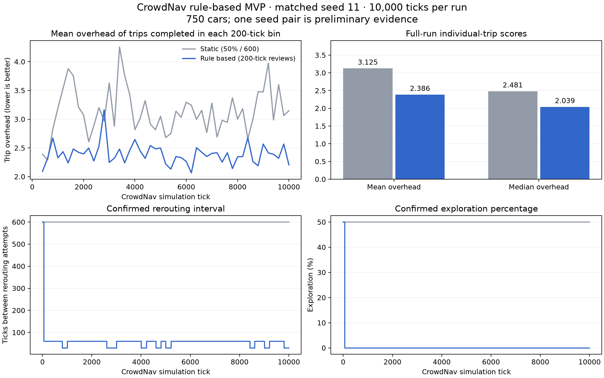

# CrowdNav evaluation results

Completed pairs: 1/1. Horizon: 10,000 ticks per run.

Adaptive strategy: `rule-based`. Static baseline: exploration `0.5`, rerouting `600` ticks, 750 cars.

| Seed | Baseline median | Adaptive median | Reduction | Baseline trips | Adaptive trips | Result |
| --- | ---: | ---: | ---: | ---: | ---: | --- |
| 11 | 2.480960 | 2.038588 | 17.83% | 2940 | 3847 | PASS |

Lower median overhead is better; ties fail. A positive reduction means improvement.

`runs.csv` includes mean, median, p90/p95, trip count, complaints, configuration changes,
and wall time (including startup). `pairs.csv` contains the paired comparison.

Both run directories contain `overhead_by_tick.csv` (one row for every simulation tick) and
`overhead_200ticks.csv` (nonoverlapping 200-tick intervals). These include exact completed-trip
mean/median, cumulative mean/median, counts, and confirmed settings. Blank overheads mean no trips
completed. `overhead_comparison_200ticks.csv` combines both policies with seed and policy labels.

Scores use CrowdNav's existing smart-car trip events after its 200-tick warmup,
through tick 10,000 inclusive. Raw events, full configuration history and logs are
in each run's data directory. Strategies run in local Python; only backbones use Docker.

These results describe the tested seeds and policy snapshot; they do not guarantee
improvement on unseen seeds. Host load can affect a policy that polls in wall-clock time.

| Seed | Run | Mean overhead | p95 overhead | Trips | Complaint rate | Config changes |
| --- | --- | ---: | ---: | ---: | ---: | ---: |
| 11 | baseline | 3.125213 | 7.108140 | 2940 | 24.08% | 0 |
| 11 | strategy | 2.386012 | 4.827883 | 3847 | 16.45% | 16 |

Rule reviews recorded: 49. Decisions are scheduled every 200 simulation ticks; HTTP polling observed boundaries a mean of 6.9 ticks late (maximum 12). `decisions.csv` records recent overhead, selected rules and settings.

The startup correction sets exploration to 0% and rerouting to 60 ticks. Subsequent rules use 0% / 30 for overhead >= 2.5, 5% / 90 for overhead <= 2.0, and 0% / 60 otherwise. A review with fewer than ten completed trips holds the settings and accumulates more evidence.

This is an opt-in, uncommitted experiment. Standard defaults remain `reactive`.

On this seed, mean overhead fell from 3.125213 to 2.386012 (23.65%).
Exploration stayed at 0% after the startup correction; the low-overhead exploration
rule did not trigger. The run exercised the moderate and high-overhead rerouting
rules. This comparison does not isolate the benefit of ongoing adaptation from
the benefit of the initial 0% / 60 correction.
